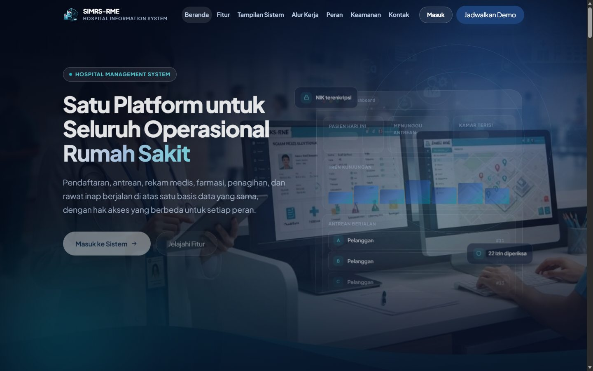
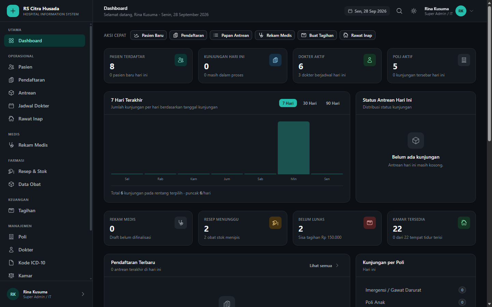
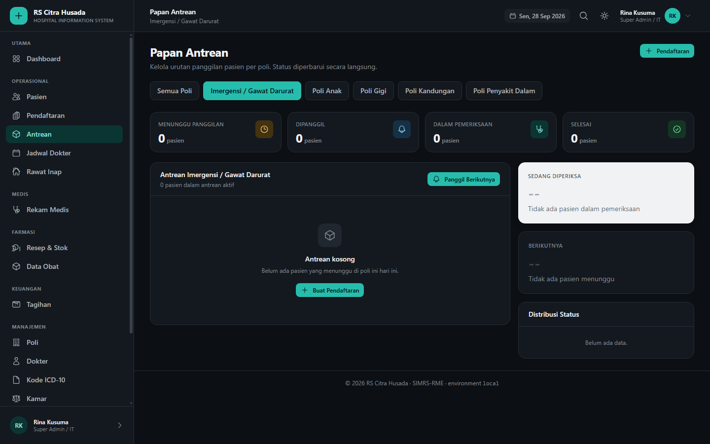
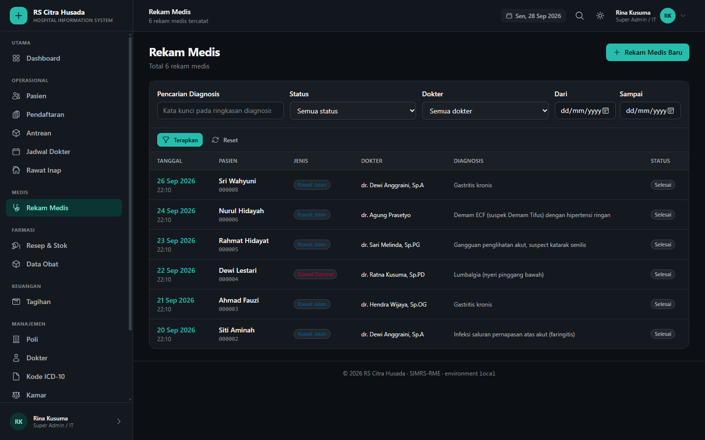
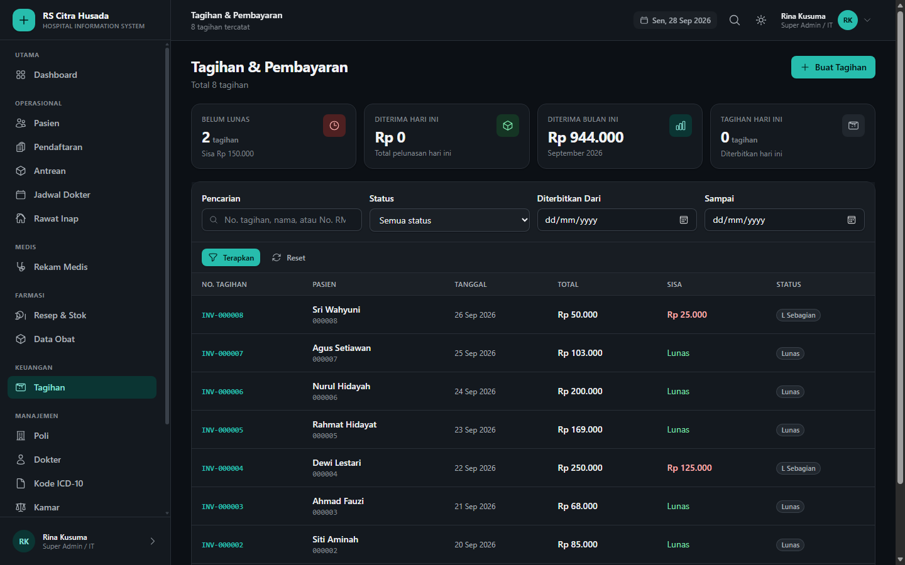

<div align="center">

# SIMRS-RME

**Sistem Informasi Manajemen Rumah Sakit — RME**

Pendaftaran, antrean, rekam medis elektronik, farmasi, penagihan, rawat inap,
jadwal dokter, dan laporan berjalan di atas satu basis data yang sama, dengan
hak akses berbeda untuk setiap peran.

[](https://www.php.net/)
[](https://laravel.com/)
[](https://www.postgresql.org/)
[](https://tailwindcss.com/)
[](https://vuejs.org/)
[](https://alpinejs.dev/)

</div>

> **PENTING — Repository ini tidak dapat langsung dijalankan.**
>
> Yang dipublikasikan hanya kode sumber. Berkas `.env`, basis data, `vendor/`,
> dan `node_modules/` sengaja tidak disertakan, sehingga tanpa langkah
> instalasi dan tanpa data dari pemilik, repository ini tidak menghasilkan
> sistem yang bisa dipakai. Paket instalasi beserta basis data awal hanya
> disediakan kepada pengguna yang sudah mengisi formulir
> demo. Detail hak cipta ada di [Hak Cipta dan Lisensi](#hak-cipta-dan-lisensi).

---

## Daftar Isi

- [Tangkapan Layar](#tangkapan-layar)
- [Modul](#modul)
- [Peran dan Hak Akses](#peran-dan-hak-akses)
- [Keamanan](#keamanan)
- [Kebutuhan Sistem](#kebutuhan-sistem)
- [Cara Instalasi](#cara-instalasi)
- [Akun Demo](#akun-demo)
- [Pengujian](#pengujian)
- [Struktur Proyek](#struktur-proyek)
- [Hak Cipta dan Lisensi](#hak-cipta-dan-lisensi)

---

## Tangkapan Layar

<div align="center">
  
</div>

**Landing page publik** — aplikasi Vue 3 dengan design system sendiri, terpisah
dari dashboard, dilengkapi simulasi antarmuka, penjelasan alur kerja, dan
formulir permintaan demo yang tetap bisa dikirim tanpa JavaScript.

<details>
<summary><b>Tampilkan tangkapan layar dashboard</b></summary>

**Dashboard — Super Admin**



**Papan Antrean**



**Rekam Medis Elektronik**



**Penagihan**



</details>

---

## Modul

| Modul | Ringkasan |
|---|---|
| **Dashboard** | Statistik real-time, grafik kunjungan 7/30/90 hari, distribusi status antrean, pendapatan berjalan, dan peringatan operasional. Setiap modul hanya tampil bila peran punya izinnya. |
| **Pendaftaran** | Nomor rekam medis otomatis berurutan, pendaftaran ke poli, penanda pasien gawat darurat, dan nomor antrean per poli per hari. |
| **Antrean** | Papan antrean per poli, pemanggilan otomatis ke pasien terlama menunggu, prioritas gawat darurat, dan perpindahan status yang tervalidasi. |
| **Rekam Medis** | Anamnesis, pemeriksaan fisik, diagnosis ICD-10 primer/tawak/penyerta, tindakan, dan resep. Rekam medis yang sudah difinalisasi tidak dapat diedit dan wajib memiliki diagnosis. |
| **Farmasi** | Resep berisi item obat, dosis, dan aturan pakai. Penyerahan mengurangi stok dalam satu transaksi; stok negatif dan obat kedaluwarsa ditolak. |
| **Penagihan** | Invoice otomatis dari rekam medis yang sudah final, diskon, pembayaran penuh maupun bertahap, dan pengurangan ke item resep yang sudah diserahkan. |
| **Rawat Inap** | Manajemen kamar dan tempat tidur, ketersediaan bed sesuai kebijakan jenis kelamin, pemulangan pasien yang membebaskan bed, dan pencegahan kelebihan kapasitas. |
| **Jadwal Dokter** | Jadwal per hari dengan slot durasi, deteksi bentrok, dan kapasitas yang diturunkan otomatis dari rentang jam praktik. |
| **Master Data** | Poli, dokter, kode ICD-10, dan obat lengkap dengan kategori, harga, serta stok. |
| **Laporan** | Kunjungan, pendapatan, dan trend kunjungan per periode dengan grafik. |
| **Administrasi** | Manajemen pengguna dan peran, jejak audit setiap perubahan, serta pengelolaan permintaan demo dari landing page. |
| **Landing Page** | Halaman publik tanpa autentikasi, dibangun sebagai aplikasi Vue terpisah dari dashboard. |

---

## Peran dan Hak Akses

Ada **7 peran** dengan total **22 izin granular**. Definisi kebenaran hanya ada
di enum: migrasi menyelaraskan tabel `permissions` dan `permission_role` dari
sana, dan test memverifikasi matrix di database selalu identik dengan enum.

| Peran | Jumlah Izin | Cakupan |
|---|:---:|---|
| `super_admin` | 22 | Seluruh sistem |
| `manajemen` | 11 | Semua modul operasional, laporan, audit, dan pengguna |
| `doctor` | 10 | Antrean, rekam medis, resep, jadwal, data pasien |
| `nurse` | 10 | Antrean, asesmen keperawatan, dan pembacaan rekam medis |
| `receptionist` | 8 | Pasien, pendaftaran, antrean, jadwal dokter |
| `pharmacist` | 6 | Farmasi, resep, dan data obat |
| `cashier` | 5 | Penagihan dan pembayaran saja |

Batasan ditegakkan di layer aplikasi, bukan sekadar disembunyikan dari menu:

- Kasir tidak dapat membuka rekam medis atau formulir diagnosis.
- Apoteker tidak dapat menyentuh modul penagihan maupun rawat inap.
- Resepsionis tidak dapat mencapai modul medis, farmasi, rawat inap, dan admin.
- Super Admin melewati setiap pengecekan, tetapi tetap tercatat di audit log.

Halaman, menu, dan aksi tulis untuk setiap peran divalidasi oleh
`RoleMatrixTest`, `ActionMatrixTest`, dan `RouteCoverageTest`.

---

## Keamanan

Yang ada di kode, bukan sekadar janji:

| Proteksi | Cara Kerja | Bukti |
|---|---|---|
| NIK terenkripsi saat disimpan | Enkripsi field-level lewat cast `encrypted` | `app/Models/Patient.php` |
| NIK tetap bisa dicari | Blind index HMAC pada kolom terpisah | `tests/Feature/PatientTest.php` |
| NIK disamarkan di tampilan | Masking sebagian pada seluruh halaman | `tests/Feature/SecurityTest.php` |
| Sesi tidak dapat dibajak | ID sesi diregenerasi saat login dan diinvalidasi saat logout | `tests/Feature/SecurityTest.php` |
| Akun terkunci | Dihitung per akun, bukan per alamat IP | `app/Http/Controllers/Auth/LoginController.php` |
| Rate limit login dan demo | Throttle terpisah untuk keduanya | `routes/web.php` |
| CSRF | Token pada seluruh form yang mengubah data | `app/Http/Middleware` |
| Jejak audit | Setiap create, update, dan delete tercatat; kolom sensitif disaring | `app/Observers/AuditableObserver.php` |
| SQL injection | Seluruh query memakai binding; input pencarian diperlakukan literal | `tests/Feature/SecurityTest.php` |
| XSS | Escaping bawaan Blade pada semua keluaran | `tests/Feature/SecurityTest.php` |
| Halaman error | 403, 404, 419, 429, dan 500 memakai layout sendiri tanpa membocorkan path internal | `resources/views/errors` |
| Mass assignment | `$fillable` eksplisit disertai pengujian khusus | `tests/Feature/SecurityTest.php` |

Field selain NIK, seperti alamat dan nomor telepon, disimpan apa adanya pada
konfigurasi bawaan sistem. Hal ini dinyatakan terbuka, bukan disembunyikan.

---

## Kebutuhan Sistem

| Komponen | Versi Minimum |
|---|---|
| PHP | 8.2 dengan ekstensi `pdo_pgsql`, `openssl`, `mbstring`, `fileinfo` |
| Composer | 2.x |
| PostgreSQL | 14+ |
| Node.js | 20+ atau lebih baru, hanya untuk proses build aset |

---

## Cara Instalasi

Langkah berikut untuk pengembangan lokal. Repository ini tidak menyertakan
basis data maupun berkas `.env`, jadi Anda harus menyediakannya sendiri.

```bash
# 1. Dependensi PHP
composer install

# 2. Dependensi front-end
npm install

# 3. Berkas konfigurasi
cp .env.example .env
php artisan key:generate

# 4. Sesuaikan kredensial database pada .env
#    DB_CONNECTION=pgsql
#    DB_HOST=127.0.0.1
#    DB_DATABASE=nama_database_anda
#    DB_USERNAME=user_anda
#    DB_PASSWORD=password_anda

# 5. Bangun skema dan isi data awal
php artisan migrate --seed

# 6. Bangun aset produksi
npm run build

# 7. Jalankan
php artisan serve
```

Pada XAMPP atau Apache, aplikasi diletakkan di `htdocs/<nama-proyek>/public` dan
dibuka melalui `http://localhost/<nama-proyek>/public`. Berkas `.htaccess` sudah
menangani pemasangan di subdirektori, termasuk ketika kapitalisasi URL yang
diketik berbeda dari nama folder di disk.

---

## Akun Demo

Dibuat oleh `php artisan db:seed`. **Ganti password ini sebelum dipakai di
lingkungan nyata.**

| Peran | Username | Password |
|---|---|---|
| Super Admin / IT | `superadmin` | `password` |
| Resepsionis | `receptionist` | `password` |
| Dokter | `dokter` | `password` |
| Perawat | `perawat` | `password` |
| Apoteker | `apoteker` | `password` |
| Kasir | `kasir` | `password` |
| Manajemen | `manajemen` | `password` |

---

## Pengujian

```bash
php artisan test
```

| Test | Cakupan |
|---|---|
| `SecurityTest` | Enkripsi, rate limit, lockout, XSS, SQLi, sesi, mass assignment |
| `RouteCoverageTest` | Setiap route GET dirender untuk setiap peran; tidak ada query di dalam view |
| `RoleMatrixTest` | Matrix izin enum dan database selalu identik |
| `ActionMatrixTest` | Aksi tulis diizinkan atau ditolak sesuai izin |
| `AlpineRootTest` | Setiap atribut Alpine berada di dalam akar `x-data` |
| `ViewCompilationTest` | Seluruh Blade dikompilasi menjadi PHP valid dan tidak membocorkan tag mentah |
| `BillingTest`, `PharmacyTest`, `MedicalRecordTest`, `InpatientTest`, `ScheduleTest` | Aturan bisnis tiap modul |
| `BrokenWriteActionTest` | Aksi yang dulu rusak, seperti menghapus obat yang sudah punya riwayat resep |
| `LandingTest`, `BuildAssetTest` | Landing page dirender dan aset build selalu sinkron |
| `SmokeTest`, `PatientTest`, `QueueTest` | Alur utama dan integritas data |

> **Catatan:** `AlpineRootTest` lahir dari bug nyata. Alpine hanya
> menginisialisasi subtree yang berakar pada `[x-data]` atau `[x-init]`.
> Tombol mode gelap, pembuka menu mobile, dan seluruh tombol aksi di baris
> tabel berada di luar akar tersebut sehingga tidak pernah dijalankan, tanpa
> error apa pun, sementara semua test tetap hijau. Test ini sekarang menjaga
> kelas bug itu tidak kembali.

---

## Struktur Proyek

```
app/
├── Enums/             22 izin, 7 peran, dan seluruh status domain
├── Http/Controllers/  Modular per domain: Patient, Pharmacy, Billing, Inpatient, dll
├── Models/            20 model dengan enkripsi dan cast eksplisit
├── Observers/         Jejak audit otomatis
├── Services/          Logika domain: Queue, Billing, Pharmacy, Inpatient, Report, Alert
└── Support/           Navigasi berbasis izin

resources/
├── css/app.css        Design system dashboard, Tailwind 4
├── css/landing.css    Design system landing, mandiri tanpa Tailwind
├── js/app.js          Alpine: sidebar dan tema
├── js/landing/        Aplikasi Vue 3 untuk landing page
└── views/
    ├── components/    20 komponen Blade anonim
    ├── partials/      Sidebar, topbar, toast
    └── errors/        403, 404, 419, 429, 500, 503

database/
├── migrations/        17 migrasi
├── seeders/           Data awal
└── factories/         Data uji untuk pengujian

tests/Feature/         Seluruh test fungsional
```

Prinsip yang dipegang: definisi kebenaran hanya ada di satu tempat. Izin hanya
di enum, data awal hanya di seeder, dan view tidak pernah menjalankan query.
Semua angka pada halaman datang dari controller atau service.

---

## Hak Cipta dan Lisensi

Hak cipta (c) 2026 **M. Farhan Muizaddin**. Seluruh hak dilindungi.

Repositori ini dipublikasikan **hanya untuk keperluan demonstrasi portofolio dan
review teknis**. Repository ini **tidak berlisensi open source** dan tidak memberi izin
untuk:

- menyalin, memodifikasi, atau mendistribusikan ulang kode ini;
- menjalankan sistem ini, langsung maupun tidak langsung, untuk keperluan apa
  pun, termasuk demo pribadi, uji coba, produksi, maupun pelatihan model;
- memakai antarmuka, basis kode, atau data contoh ini pada proyek lain.

Kode, basis data, dan seluruh data contoh di dalam repositori ini adalah milik
penulis. Setiap penggunaan di luar demonstrasi memerlukan **izin tertulis**
dari penulis. Permintaan penggunaan, kolaborasi, dan lisensi dapat diajukan
melalui formulir demo pada landing page.

> Dengan menyalin repositori ini Anda **tidak** memperoleh hak atas sistem ini.
> Repositori ini memang sengaja tidak memuat basis data, kredensial, maupun
> `vendor/`, sehingga tidak dapat dijalankan tanpa persetujuan pemilik.

Dibangun dengan Laravel, PostgreSQL, Tailwind CSS, Vue 3, dan Alpine.js.

---

<div align="center">

**[Kembali ke atas](#simrs-rme)**

Dibangun dengan hati oleh **M. Farhan Muizaddin**

</div>
